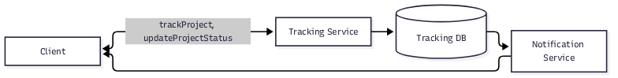

#+TITLE: Design

* Purpose
This is a document that describes the Job Tracker app from the product perspective. Its roadmap
works as a backlog because it holds the action items identified by the product owner; it works as a
tracker because its action items are toggleable todo items that should be marked as DONE when they
get implemented; and it works as a spec because the tests should prove the software satisfies the
requirements expressed in the [[*Features Overview][Features Overview]] and [[*Roadmap][Roadmap]].

This is the single source of truth for product work and specification. Roadmap items are epics:
they only flip from TODO to DONE in place once fully delivered, and are never moved out of the
Roadmap. Features Overview maps forward to the Roadmap epic(s) that deliver each feature.

Originally derived from a now-deleted =job-tracker-app.excalidraw= sketch (functional requirements,
data model, and architecture), with ambiguities resolved via clarification rather than assumption —
see [[*Open Questions][Open Questions]] for what's still explicitly undecided. This document is the living source of
truth going forward; the =.excalidraw= file was a one-time kickoff artifact, not something kept in
sync after the first draft. The one exception is the architecture diagram: it stays editable as
=architecture.mmd=, rendered to =architecture.png= for the [[*Architecture Overview][Architecture Overview]] section below, and
can be round-tripped through Excalidraw's mermaid-import when it needs visual editing — re-export,
re-extract, discard the =.excalidraw= again.

Non-functional qualities (availability, backups, scaling, etc.) are assumed covered by whichever
infra-as-a-service platform this ends up deployed to, and are only called out per-component below
when something specific is actually known.

* Features Overview
The epics in the roadmap should map to these features.

** TODO Configurable status sets per project
Select =n= (0 < n <= 5) statuses that apply to a given project, out of the overall status catalog.
Delivered by [[*Configurable status sets per project][Configurable status sets per project]].

** TODO Update and log project status
Change a project's current status, with the change recorded in a history log (including a note).
Delivered by [[*Update and log project status][Update and log project status]].

** TODO View project history
See the history of status changes for a project. Delivered by [[*Update and log project status][Update and log project status]].

** TODO Project templates
Save a named, reusable bundle of statuses (e.g. "Job Application": no response / first contact /
interviewed / offer / rejected) so creating a new project of the same kind doesn't require
reselecting its statuses from scratch. Delivered by [[*Project templates][Project templates]].

** TODO Alarms and notifications
Configure an alarm on a project that triggers a notification carrying some text. Delivered by
[[*Alarms and notifications][Alarms and notifications]].

** DONE User accounts
:LOGBOOK:
- State "DONE"       from "TODO"       [2026-11-09 Mon 19:29]
:END:
Sign in with Google; projects belong to the signed-in user. Delivered by [[*User accounts][User accounts]].

** DONE Track projects
:LOGBOOK:
- State "DONE"       from "TODO"       [2026-11-09 Mon 22:18]
:END:
Create and list projects being tracked. Delivered by [[*Track projects][Track projects]].

* Roadmap

Open (TODO) items are listed first, in priority order, highest priority first. Completed (DONE)
items are kept at the end of the list, in descending order by the date of their last TODO to DONE
transition, rather than mixed in with what's still open.

** TODO Configurable status sets per project
:PROPERTIES:
:CREATED: [2026-11-05 Wed]
:END:
Delivers [[*Configurable status sets per project][Configurable status sets per project]]. Each project selects up to 5 statuses from the
overall =Project Status= catalog — the =ProjectStatusConfiguration= table (see [[*Data Model][Data Model]]) records
that selection as one row per (project, status) pair.

** TODO Update and log project status
:PROPERTIES:
:CREATED: [2026-11-05 Wed]
:END:
Delivers [[*Update and log project status][Update and log project status]] and [[*View project history][View project history]]. Changing a project's current
status writes a row to =Project Status Log= (who/when/what), which is also what powers the history
view. The functional requirement to "add notes to the project change of state" implies a notes/text
field on this log that isn't in the original diagram — see [[*Open Questions][Open Questions]].

** TODO Project templates
:PROPERTIES:
:CREATED: [2026-11-05 Wed]
:END:
Delivers [[*Project templates][Project templates]]. A named, reusable status-set bundle (e.g. "Job Application") applied when
creating a new project, instead of re-selecting the same statuses every time. The underlying schema
for this isn't in the original diagram at all — see [[*Open Questions][Open Questions]] for the shape this likely needs
(something like a =ProjectTemplate= entity plus its own status-set rows, applied by copying into a
new project's =ProjectStatusConfiguration= at creation time).

** TODO Alarms and notifications
:PROPERTIES:
:CREATED: [2026-11-05 Wed]
:END:
Delivers [[*Alarms and notifications][Alarms and notifications]]. Configure an alarm on a project that triggers a notification
carrying some text. Delivery is a dedicated =Notification Service= (see [[*Architecture Overview][Architecture Overview]]) running
on a schedule (e.g. once a morning) that reads due alarms straight from Tracking DB and delivers to
the client directly — deliberately bypassing Tracking Service on both sides. The actual delivery
channel (push/email/in-app/other) is still open — see [[*Open Questions][Open Questions]].

** TODO Set up scheduled-job infrastructure for the Notification Service :infra:
:PROPERTIES:
:CREATED: [2026-11-05 Wed]
:END:
Delivers the infra side of [[*Alarms and notifications][Alarms and notifications]]. The Notification Service runs as a scheduled
job (cron-like, e.g. once a morning) rather than a long-running request-serving process — needs a
deploy target that supports scheduled tasks, separate from (but able to reach) Tracking DB.

** DONE User accounts
:PROPERTIES:
:CREATED: [2026-11-05 Wed]
:END:
:LOGBOOK:
- State "DONE"       from "TODO"       [2026-11-09 Mon 19:29]
:END:
Delivers [[*User accounts][User accounts]]. Sign in with Google (Passport + =passport-google-oauth20=, session-based —
same approach as =tempo-app=, see [[*Tech Stack][Tech Stack]]), and every =Project= belongs to the signed-in
=User= (see [[*Data Model][Data Model]]). This is foundational, same as [[*Track projects][Track projects]] — projects can't be
scoped to a user until this exists. Identity is keyed on the Google account (not an app-local
username/password) since pocoapoco-app, =tempo-app=, and the loyalty app belong to one suite that
may eventually share user identity — see [[*Future shared identity across the suite][Future shared identity across the suite]].

The client surfaces this as a dedicated full-screen sign-in view (ambient grid, glow orb, centered
card, branded "Continue with Google" button) deliberately mirroring =tempo-app='s =LoginPage=, so
the sign-in experience is coherent across the suite — both apps already share the same =tempo-theme=
submodule, so the view reuses the same tokens and only differs in that this app uses plain global
CSS rather than CSS Modules. The backend exposes =GET /auth/me= for the client to resolve auth state
(the session cookie is HttpOnly), and CORS/cross-site cookie settings (=SameSite=None; Secure=
behind the proxy) are gated on =NODE_ENV=production= so the Cloudflare-hosted client and this service
can share a session across origins.

** DONE Set up Postgres with a migration-based workflow               :infra:
:PROPERTIES:
:CREATED: [2026-11-05 Wed]
:END:
:LOGBOOK:
- State "DONE"       from "TODO"       [2026-11-09 Mon 21:13]
:END:
Tracking DB is Postgres (see [[*Tech Stack][Tech Stack]]), with schema changes going through a migration tool
from day one rather than hand-editing the schema — the project expects real schema churn during
early development as the data model above settles.

** DONE Containerize and deploy the Tracking Service                  :infra:
:PROPERTIES:
:CREATED: [2026-11-05 Wed]
:END:
:LOGBOOK:
- State "DONE"       from "TODO"       [2026-11-09 Mon 21:13]
:END:
Tracking Service runs as a containerized web server (see [[*Tech Stack][Tech Stack]]). Covers building the
container image and getting it deployed — concrete steps TBD, see [[*Deployment][Deployment]].

** DONE Track projects
:PROPERTIES:
:CREATED: [2026-11-05 Wed]
:END:
:LOGBOOK:
- State "DONE"       from "TODO"       [2026-11-09 Mon 22:18]
:END:
Delivers [[*Track projects][Track projects]]. Basic create/list capability for projects — =name=, =description=, and a
current status (=projectStatusId=), scoped to the signed-in user (see [[*User accounts][User accounts]]). Foundational
epic everything else below builds on. Backend exposes =POST /projects= / =GET /projects= (scoped to
the signed-in user, the list joining each project's current =Project Status= name) plus
=GET /project-statuses= for the catalog the create form's status picker reads; the client adds a
create-project form (name, description, status) alongside the existing list.

* Architecture Overview

Four components. Arrow direction reflects the direction data flows, not necessarily "who calls
whom" — the Client/Tracking Service relationship is a two-way request/response over the API even
though it's drawn as one arrow (Excalidraw has no easy bidirectional-arrow tool); the Notification
Service's two arrows are genuinely one-directional reads/deliveries, not round trips.

Source: =architecture.mmd= (regenerate the PNG after editing it: =mmdc -i architecture.mmd -o
architecture.png=).

- *Client* — a web client (browser). Other client types (mobile, desktop) may be added later; see
  [[*Tech Stack][Tech Stack]].
- *Tracking Service* — a containerized NestJS (Express) web server. Exposes the API below; owns all
  reads/writes to Tracking DB. See [[*Tech Stack][Tech Stack]].
- *Tracking DB* — Postgres. Holds the entities in [[*Data Model][Data Model]].
- *Notification Service* — runs on a schedule (e.g. once a morning, cron-like) rather than serving
  requests. Reads due alarms directly from Tracking DB and delivers notifications directly to the
  Client — deliberately decoupled from Tracking Service on both sides, not an oversight. The actual
  delivery channel (push/email/in-app) is still open — see [[*Open Questions][Open Questions]].

** API (high level)
The source diagram's =POST /events/track= / =PATCH /events/:eventId/status= (=trackProject()=/
=updateProjectStatus()=) were illustrative, named after "event" rather than the =Project= entity
the Data Model actually settled on. Scaffolding the Tracking Service translates them to the real
entity naming below — still not a full contract (no request/response bodies specified yet beyond
what's implied by [[*Data Model][Data Model]]).

- ~POST /projects~ — create a project and start tracking it (=name=, =description=,
  =projectStatusId=), scoped to the signed-in user.
- ~PATCH /projects/:id/status~ — update a project's current status. Body: =projectStatusId= (fk
  into the =Project Status= catalog, not a fixed enum) plus the optional notes field for
  =Project Status Log= (see [[*Open Questions][Open Questions]]). Writes a =Project Status Log= row as a side effect.
- All routes require a signed-in user (see [[*User accounts][User accounts]]); =Project= rows are scoped to
  =userId=.

* Data Model

#+BEGIN_SRC sql
User
----------
id
googleId  -- Google account's stable subject id ("sub"); the durable identifier, not an
          -- app-local username/password — see Open Questions, Future shared identity
email

Project
----------
id
userId (fk -> User.id)
name
description
projectStatusId (fk -> Project Status.id)

Project Status
-------
id
name

Project Status Log
-------
logged_at
projectId (fk -> Project.id)
projectStatusId (fk -> Project Status.id)
-- notes/comment field needed (see Open Questions) — not in the original diagram

ProjectStatusConfiguration
-------
projectId (fk -> Project.id)
projectStatusId (fk -> Project Status.id)
(projectId, projectStatusId) (pk)
#+END_SRC

=ProjectStatusConfiguration= was named =Project Config=/=Project Configuration= inconsistently in
the source diagram (the entity index said one thing, the table itself said another) — renamed to
this single canonical name per clarification.

=Project Templates= (the feature) has no corresponding entity above yet — it wasn't drawn in the
source diagram at all. See [[*Open Questions][Open Questions]].

* Tech Stack

- *Tracking DB: Postgres.* Chosen with a migration-based workflow in mind from the start, since the
  data model above is expected to keep changing during early development (e.g. once the Project
  Templates schema gap below gets resolved). Specific migration tool not yet chosen.
- *Tracking Service: NestJS (Express) + TypeORM, targeting Postgres.* Same stack as =tempo-app='s
  backend — NestJS/Express/TypeORM/=class-validator=/Passport (Google OAuth, session-based) —
  except the DB driver, since Tracking DB is Postgres rather than SQLite; TypeORM supports Postgres
  natively and has a real migration CLI, which fits the migration-based workflow above directly.
  Reusing =tempo-app='s stack is deliberate, not incidental: same owner, same intended suite (see
  [[*Future shared identity across the suite][Future shared identity across the suite]]). Runs as a container (see [[*Containerize and deploy the
  Tracking Service][Containerize and deploy the Tracking Service]]).
- *Notification Service: a scheduled job, not a request-serving service.* Same "abstract until
  named" treatment as Tracking Service for language/framework — the one settled property is that it
  runs on a schedule (cron-like) and reaches Tracking DB directly rather than through Tracking
  Service. See [[*Set up scheduled-job infrastructure for the Notification Service][Set up scheduled-job infrastructure for the Notification Service]].
- *Client: web (browser), built as an installable PWA.* An SPA using [[https://mithril.js.org/][Mithril]] — chosen for being
  lightweight and close to vanilla JS rather than a heavier component framework. Installable (manifest +
  service worker) so it can be added to the home screen on iOS/Android instead of shipping separate
  native clients.

* Deployment

This section covers the design/rationale; see [[file:DEPLOYMENT.md][DEPLOYMENT.md]] for the step-by-step operational
guide (account setup, secrets, first deploy, ongoing operations, backups) — same split as
=tempo-app='s =DESIGN= doc vs. its own =DEPLOYMENT.md=.

** Client
Deployed as static assets to [[https://developers.cloudflare.com/workers/static-assets/][Cloudflare Workers Static Assets]] — no server, container, or
VPS for the frontend. =frontend/wrangler.toml= configures a default (production) and an
=[env.staging]= environment, both serving =frontend/dist= with SPA fallback
(=not_found_handling = "single-page-application"=) so client-side routing works on refresh/deep
link.

=frontend/dist= is assembled by =frontend/scripts/build.mjs= as a complete, self-contained site
root — =index.html=, the PWA manifest, service worker, theme CSS (from the =frontend/theme=
submodule), and the bundled JS all sit flat under =dist/= — rather than just the JS bundle, since
that's what Wrangler publishes directly. The dev server (=npm run dev=) serves from the same
=dist/= layout, so local dev matches what ships.

Deploy is via GitHub Actions (=.github/workflows/deploy.yml= for =main= → production,
=deploy-staging.yml= for =staging= → staging): checkout (with submodules, for =frontend/theme=),
=npm ci=, =npm test=, =npm run build= (=API_BASE_URL=/=API_BASE_URL_STAGING= injected from repo
secrets — see [[*Environment variables][Environment variables]] below), then
=cloudflare/wrangler-action@v3= to publish. Modeled on the =loyalty-app-web= repo's deploy setup,
adapted for this repo's =frontend/= subdirectory layout and esbuild (rather than Vite) build.

The Client is deployed and running live in production on Cloudflare: the Cloudflare account/API
token, repo secrets, and GitHub remote are all in place, and the pipeline publishes on push to
=main=.

*** Environment variables
=API_BASE_URL= is injected at build time (see [[*Tech Stack][Tech Stack]] — =frontend/scripts/build.mjs= loads it
via =dotenv= from =.env.development=/=.env.production= locally, or from a real =API_BASE_URL=
environment variable in CI, which takes precedence over the =.env= file). =.env.production='s
=API_BASE_URL= now points at the live deployed Tracking Service (it was a placeholder until the
Tracking Service was deployed — see [[*Hosting target][Hosting target]] below, now resolved).

** Tracking Service / Tracking DB
Deploy mechanism is prepared, deliberately matching =tempo-app='s shape as closely as possible
(single environment, =:latest= image tag, =git pull= + =docker compose pull/up= on the server
rather than per-commit tags + file copying, decoupled test-then-deploy via =workflow_run=) since
both belong to the same suite — see [[*Future shared identity across the suite][Future shared identity across the suite]]. Postgres instead of
SQLite (plus the migration step that requires) is the one deliberate divergence; see [[*Tech Stack][Tech Stack]].
The Tracking Service and Tracking DB are *deployed and running live* on their deploy target (the
shared droplet behind Caddy, per =backend/compose.yaml= below), via the pipeline described here;
the client's =API_BASE_URL= points at this live service.

=backend/compose.yaml= defines an =app= + =db= (Postgres) pair, joining the shared external
=droplet_proxy_network= — same external-network pattern =tempo-app= and =loyalty-app-api= already
use to share one droplet behind one Caddy instance. =backend/compose.dev.yaml= is a separate,
local-dev-only file (Postgres only, no app container); Docker Compose would otherwise silently
prefer a file named =compose.yaml= over it, which is why the dev one is explicitly suffixed rather
than left as the ambiguous default =docker-compose.yml= name.

=.github/workflows/backend-tests.yml= (push/PR to =main=, scoped to =backend/**=) runs the test
suite standalone, decoupled from deploy — same split as =tempo-app='s =e2e.yml=/=deploy.yml=.
=backend-deploy.yml= triggers via =workflow_run= once that succeeds (or manually via
=workflow_dispatch=): build+push a =:latest= image to GHCR, then SSH in and =git pull && docker
compose pull && up -d --remove-orphans=, same as =tempo-app='s =deploy.yml=. The one addition
=tempo-app= doesn't have is a migration step after =up= (=npm run migration:run:prod=, compiled-JS
TypeORM CLI — the =ts-node=-based =migration:run= used locally isn't available in the production
image, which only installs production dependencies) — kept deliberately as the template for
=tempo-app='s own eventual SQLite-to-Postgres migration, even though =tempo-app= doesn't need it
yet itself.

** Notification Service
Not yet written — no hosting target chosen (see [[*Hosting target][Hosting target]] in Open Questions).

* Open Questions

- *Notification delivery channel.* The Notification Service's existence, trigger mechanism (a
  scheduled job reading Tracking DB directly), and decoupling from Tracking Service are settled —
  see [[*Architecture Overview][Architecture Overview]]. What's still open is the actual delivery channel to the client (push,
  email, in-app, something else). If the Client ends up being an installable PWA (see [[*Client
  specificity][Client specificity]]), push on iOS specifically constrains this: push only works for a PWA
  installed via "Add to Home Screen" (not in a regular Safari tab), requires iOS/iPadOS 16.4+, and
  the permission prompt can only be triggered by a user gesture post-install. Delivery itself would
  be Web Push (VAPID-signed) against per-device push subscriptions rather than a single "deliver to
  the client" call, which means a push-subscription table (per device, not yet in [[*Data
  Model][Data Model]]) and tolerance for stale/rotated subscriptions, since Safari's
  =pushsubscriptionchange= handling has been unreliable historically. Android/Chrome has none of
  these restrictions.
- *Project Templates schema.* The feature (save a named, reusable status-set bundle — e.g. a "Job
  Application" template with statuses no response / first contact / interviewed / offer / rejected
  — so new projects of the same kind don't need re-selecting statuses) has no entity in the source
  diagram. Likely shape: a =ProjectTemplate= entity (id, name) plus its own status-set rows
  (mirroring =ProjectStatusConfiguration=), copied into a new project's =ProjectStatusConfiguration=
  at creation time — not yet confirmed.
- *Project Status Log notes field.* "Add notes to the project change of state" implies a text field
  on =Project Status Log= that isn't in the source diagram's table definition. Assumed needed, not
  yet named/typed.
- *Client specificity.* Settled as an installable PWA (Mithril SPA) — see [[*Tech Stack][Tech Stack]]. Dedicated
  native mobile/desktop clients are not planned; the installable PWA is the mobile delivery
  mechanism.
- *Hosting target.* Resolved for the Client (Cloudflare Workers Static Assets), the Tracking
  Service, and the Tracking DB — all deployed and running live in production (see [[*Deployment][Deployment]]), with
  the Client's =API_BASE_URL= pointed at the live Tracking Service. Still open only for the
  Notification Service, which isn't built yet.
- *Cross-origin vs. same-origin Client/Service.* Current design is deliberately cross-origin in prod:
  the Client is static assets on Cloudflare while the Tracking Service is on a separate host, so the
  Client calls an absolute =API_BASE_URL= and auth relies on CORS plus cross-site session cookies
  (=SameSite=None; Secure=). =tempo-app= instead is same-origin (one host serves the SPA and proxies
  =/api= to the backend), which lets it use =SameSite=lax= and no CORS. pocoapoco could move to the
  same model by having the Cloudflare Worker proxy =/api/*= through to the Tracking Service (the
  Client would then use a relative =/api= base) — but that abandons the "static assets, no server"
  property of the current Client deploy. Not pursued now; flagged so the trade-off is a conscious
  choice if the cross-site-cookie handling (esp. Safari/PWA) proves troublesome. Note this is a
  prod-only question: local dev already runs the real Tracking Service (see
  [[file:frontend/README.org][frontend/README.org]], "Running in development"), cross-origin, which matches prod.
- *Future shared identity across the suite.* pocoapoco-app, =tempo-app=, and the loyalty app belong
  to one suite (same owner) that may eventually share user accounts rather than each having fully
  independent ones. Not being built now, but it shapes the =User= entity above: =googleId= (the
  Google account's stable subject id) is the durable identifier, not an app-local auto-increment
  username/password scheme that would need migrating later if identity does get unified.
